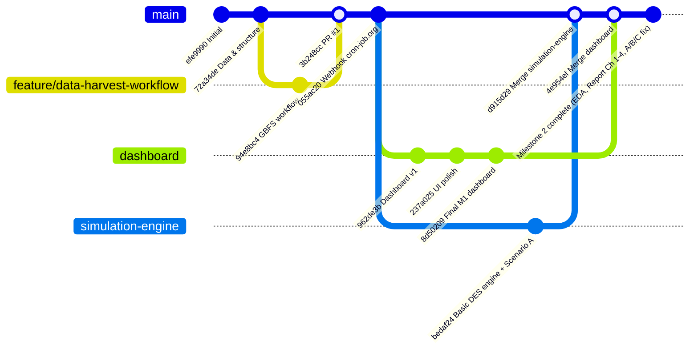

# Obecny Stan Projektu: Symulacja Dyskretna i Optymalizacja Relokacji Citi Bike NYC

**Data aktualizacji:** 2026-10-31 (po merge'u `simulation-engine` i `dashboard` do `main` oraz ukończeniu Milestone 2)  
**Punkt odniesienia:** [`plan_realizacji_projektu_citi_bike_nyc.md`](./plan_realizacji_projektu_citi_bike_nyc.md) oraz [`CONTRACTS.md`](./CONTRACTS.md)

---

## 1. Podsumowanie Wykonawcze (Executive Summary)

Gałęzie `simulation-engine` oraz `dashboard` zostały bezkonfliktowo zmergowane do gałęzi głównej `main`. Zsynchronizowano 388 migawek GBFS z gałęzi `origin/data-gbfs`, pobrano i przetworzono pełny zbiór danych z września `2026-09` ($4\,982\,855$ surowych przejazdów $\to$ $383$ stacje dolnego Manhattanu i $2\,685\,269$ oczyszczonych przejazdów), uruchomiono przebieg bazowy DES dla Scenariusza A (`A_n0_s1.json`) oraz wygenerowano analizę EDA (3 figury wektorowe `.pdf`/`.png`) i dokument raportu z kompletnymi Rozdziałami 1–4 ([`reports/raport_citi_bike_nyc.md`](./reports/raport_citi_bike_nyc.md)).

| Milestone | Status ogólny | Szacowany postęp | Podsumowanie |
| :--- | :---: | :---: | :--- |
| **Milestone 1:** Fundament, Kontrakt Danych i Pipeline | **UKOŃCZONY** | **100%** | Struktura repozytorium, kontrakty Pydantic (`CONTRACTS.md`), pipeline Polars (`01_prepare_data.py`), pobieranie danych i pogody (`00_download_data.py`), mocki (`A`, `B`, `C`) oraz zbieracz GBFS (`data-gbfs` + `sync_gbfs.py`) działają w pełni. |
| **Milestone 2:** Kalibracja Matematyczna i MVP Symulatora + Mapy | **UKOŃCZONY** | **100%** | Kalibracja $\lambda_i(t)$, korekta cenzurowania `exposure_frac` ($+19,55\%$ ukrytego popytu), macierz OD ($5{,}07\text{ mln}$ wierszy), mnożnik pogodowy ($0{,}55$), silnik DES ze Scenariuszem A (`02_run_simulation.py`), Dashboard 3D (`04_dashboard_app.py`), wykresy EDA (`05_eda_report.py`, `src/viz/eda.py`) i Rozdziały 1–4 raportu (`reports/raport_citi_bike_nyc.md`) są w 100% gotowe. |
| **Milestone 3:** Walidacja Modelu i Heurystyki Relokacji B oraz C | **W TRAKCIE** | **~30%** | Zadanie `Task 3.4` (widok Split-Screen + animacja furgonetek w PyDeck `TripsLayer`/`ArcLayer`) jest już w 100% zrealizowane w `scripts/04_dashboard_app.py`. Do implementacji pozostają heurystyki furgonetek B i C (`Task 3.2`, `Task 3.3`) oraz walidacja na Tygodniu 4 (`Task 3.1`). |
| **Milestone 4:** Wielkie Eksperymenty, Weryfikacja Hipotez H1–H6 i Finał | **ROZPOCZĘTY** | **~20%** | Generator strumienia klientów obsługuje już deterministyczne ziarna *Common Random Numbers* (CRN), a dashboard posiada karty KPI i porównania (`Task 4.3` częściowo). Do napisania pozostaje `scripts/03_batch_experiments.py`, testy statystyczne H1–H6, wideo awaryjne i wnioski końcowe. |

---

## 2. Stan Gałęzi Git po Merge'u

### Co znajduje się obecnie na gałęzi `main`:
1. **Pipeline ETL i Kalibracja (`src/pipeline/`, `scripts/00_download_data.py`, `scripts/01_prepare_data.py`):**
   - `stations.json` — 383 stacje w wielokącie `MANHATTAN_POLYGON` (pojemność łączna $22\,401$ doków).
   - `trips_clean.parquet` — $2\,685\,269$ oczyszczonych przejazdów ($2\,183\,859$ kalibracja `1–23.09`, $501\,410$ walidacja `24–30.09`).
   - `lambda_15min.parquet` — intensywności $\lambda_i(t)$ oraz `return_rate` z korektą cenzurowania `exposure_frac` z 388 migawek GBFS (średnia ekspozycja w dni robocze $90{,}38\%$, odzyskany ukryty popyt $+19{,}55\%$).
   - `od_matrix.parquet` — $5\,069\,952$ wierszy macierzy przejść z wygładzaniem Bayesowskim ($\alpha=5.0$) i rozkładami log-normalnymi czasu przejazdu (mediana $631\text{ s} = 10{,}5\text{ min}$).
   - `weather.py` — empiryczny mnożnik deszczowy $w_{\text{rain}} = 0.55$.
2. **Silnik Symulacji DES (`src/engine/`, `src/strategies/`, `scripts/02_run_simulation.py`):**
   - `demand_gen.py` — generator NHPP metodą przerzedzania Lewisa–Shedlera z pełnym wsparciem *Common Random Numbers* (CRN).
   - `des.py` — pętla zdarzeń `heapq`, przekierowania piesze ($p=0.4$ do $500\text{ m}$), przekierowania przy pełnych stacjach, naliczanie `empty_station_min` i `full_station_min`.
   - Wygenerowany przebieg bazowy `data/outputs/snapshots/A_n0_s1.json` oraz `data/outputs/metrics/metrics_runs.csv` i `metrics_hourly.csv` (czas wykonania 24h symulacji: `1.20 s`).
3. **Interaktywny Dashboard 3D (`scripts/04_dashboard_app.py`):**
   - Mapa 3D w Streamlit + PyDeck (CARTO Dark Matter), tryb `Split-Screen` oraz `Pojedyncza`, animacja furgonetek (`TripsLayer`, `ArcLayer`, beacony 3D po siatce ulic obróconej o $29^\circ$), odtwarzacz z interpolacją co 1 minutę, karty KPI i 3 zakładki analityczne.
   - Obsługuje wszystkie trzy scenariusze `A`, `B`, `C` zarówno z `data/outputs/snapshots/`, jak i `data/mock/`.
4. **Analiza Eksploracyjna Danych (EDA) i Raport (`src/viz/eda.py`, `scripts/05_eda_report.py`, `reports/`):**
   - Figury wektorowe (`.pdf` + `.png` 300 DPI) w `reports/figures/`:
     - `fig1_spatial_asymmetry.{png,pdf}` — Mapa przestrzennej asymetrii popytu rano (07–10) vs po południu (16–19) (*Pozycja #1 z Checklisty Wykresów na 5.0*).
     - `fig2_diurnal_asymmetry.{png,pdf}` — Dobowy profil wypożyczeń (dni robocze vs weekend + efekt korekty cenzurowania) oraz mapa cieplna bilansu netto wg 5 stref Manhattanu.
     - `fig3_calibration_diagnostics.{png,pdf}` — Dopasowanie rozkładu log-normalnego czasów jazdy, profil ekspozycji GBFS oraz godzinowy profil odrzuconych klientów w Scenariuszu A.
   - Raport [`reports/raport_citi_bike_nyc.md`](./reports/raport_citi_bike_nyc.md) (kompletne Rozdziały 1–4 + szkielet Rozdziałów 5–7) oraz plik statystyk [`reports/eda_summary.json`](./reports/eda_summary.json).
5. **Testy jednostkowe (`tests/`):**
   - 17 testów jednostkowych (`test_contracts.py`, `test_pipeline.py`, `test_engine.py`, `test_eda.py`) — **100% przechodzi (`17 passed`)**.

---

## 3. Mapowanie Stanu Projektu na Plan Realizacji (`plan_realizacji_projektu_citi_bike_nyc.md`)

### MILESTONE 1: Fundament, Kontrakt Danych i Pipeline — **100% GOTOWE**
- **[Task 1.1] Inicjalizacja repozytorium i Kontraktu Danych:** **GOTOWE (100%)**
- **[Task 1.2] Pobranie danych i filtracja przestrzenna w Polars:** **GOTOWE (100%)**
- **[Task 1.3] Uruchomienie skryptu zbierającego migawki GBFS:** **GOTOWE (100%)**
- **[Task 1.4] Pobranie danych pogodowych:** **GOTOWE (100%)**

### MILESTONE 2: Kalibracja Matematyczna i MVP Symulatora + Mapy — **100% GOTOWE**
- **[Task 2.1] Kalibracja NHPP, Macierzy OD i korekta cenzurowania:** **GOTOWE (100%)**
- **[Task 2.2] Silnik DES (`heapq`) i Scenariusz A – Bazowy:** **GOTOWE (100%)**
- **[Task 2.3] Dashboard MVP w Streamlit + PyDeck:** **GOTOWE (100%)**
- **[Task 2.4] Szkielet raportu (Rozdziały 1–4) i Analiza Eksploracyjna Danych – EDA:** **GOTOWE (100%)**

### MILESTONE 3: Walidacja Modelu i Heurystyki Relokacji B oraz C — **~30% GOTOWE**
- **[Task 3.1] Walidacja dwuetapowa na Tygodniu 4 – Hipoteza H0:** **DO ZROBIENIA (0%)**
- **[Task 3.2] Model Agenta Furgonetki i Scenariusz B – Reaktywny:** **W TRAKCIE (~20% — gotowy szkielet `VanAgent`, `BaseStrategy` i hooki w `des.py`)**
- **[Task 3.3] Scenariusz C – Predykcyjny / Dynamiczny:** **W TRAKCIE (~20% — gotowe $\lambda_{\text{out}}$ i $\lambda_{\text{in}}$ w `lambda_15min.parquet` oraz hooki `on_tick`)**
- **[Task 3.4] Rozbudowa Wizualizacji do trybu „Split-Screen” i animacji Vanów:** **GOTOWE (100%)**

### MILESTONE 4: Wielkie Eksperymenty, Weryfikacja Hipotez H1–H6 i Finał — **~20% GOTOWE**
- **[Task 4.1] Batch Runner z Common Random Numbers – CRN (`03_batch_experiments.py`):** **W TRAKCIE (~25% — gotowy deterministyczny generator CRN i zapis metryk)**
- **[Task 4.2] Testy statystyczne i generowanie wykresów do raportu (H1–H6):** **DO ZROBIENIA (0%)**
- **[Task 4.3] Szlif wizualizacji i nagranie gifa/wideo awaryjnego:** **PRAWIE GOTOWE (~80% — pozostaje nagranie wideo z przebiegów A/B/C)**
- **[Task 4.4] Redakcja wniosków końcowych i rekomendacji:** **DO ZROBIENIA (0%)**

---

## 4. Kolejne Kroki (Plan Działań na Milestone 3 i Milestone 4)

### Krok 1 (Zespół A — Osoba 2 + Osoba 1): Implementacja Heurystyk Furgonetek (Scenariusze B i C — Milestone 3)
1. **[Task 3.2] `src/strategies/reactive.py` (`ScenarioB`):**
   - Inicjalizacja $N$ furgonetek (`VanAgent`) o pojemności `van_capacity = 25`, pracujących w godzinach `06:00–22:00` (`21600..79200` s).
   - Prędkość przejazdu zależna od pory dnia po dystansie `sim.dist_m` (metryka Manhattan) + czas obsługi stacji (stały + per rower).
   - Reakcja na przekroczenie progów `thr_low` ($10\%$) i `thr_high` ($90\%$): parowanie kursów `pickup` ze stacji pełnej $\to$ `dropoff` do stacji pustej z priorytetem według bieżącego $\lambda_i(t)$ i odległości.
   - Zapisywanie odcinków w `self.van_legs` oraz aktualizacja `v.km_total` i `self.bikes_moved`.
2. **[Task 3.3] `src/strategies/predictive.py` (`ScenarioC`):**
   - Co 15 minut (`on_tick`) wyliczanie prognozy bilansu każdej stacji w horyzoncie `horizon_min` ($H = 60\text{ min}$) na podstawie `lambda` ($\lambda_{\text{out}}$) oraz `return_rate` ($\lambda_{\text{in}}$) z `lambda_15min.parquet`.
   - Wyprzedzające wysyłanie wolnych furgonetek przed szczytem porannym i popołudniowym (zachłanna heurystyka *Pickup and Delivery*).
3. Podpięcie `ScenarioB` i `ScenarioC` w `scripts/02_run_simulation.py` oraz dodanie testów jednostkowych w `tests/test_engine.py`.

### Krok 2 (Zespół B — Osoba 4 + Osoba 1): Walidacja Modelu na Tygodniu 4 — Hipoteza H0 (`Task 3.1`)
1. Porównanie symulowanych profili wypożyczeń i zwrotów z rzeczywistymi przejazdami ze zbioru walidacyjnego `split == "valid"` (24–30 września):
   - Wyliczenie **MAE, RMSE, MAPE, korelacji Pearsona $r$** dla profili dobowych oraz **testu Kołmogorowa–Smirnowa (K-S)** dla czasów przejazdu.
   - Porównanie krzywych zapełnienia / czasu niedostępności z migawkami GBFS.
   - Wygenerowanie wykresu walidacyjnego (*Pozycja #2 z Checklisty Wykresów*) i uzupełnienie **Rozdziału 5** w `reports/raport_citi_bike_nyc.md`.

### Krok 3 (Wszyscy): Wielkie Eksperymenty CRN i Finał Raportu (`Task 4.1` – `4.4`)
1. Stworzenie `scripts/03_batch_experiments.py` uruchamiającego wielordzeniowo 30 replikacji (`seed = 1..30`, wspólne liczby losowe CRN) dla:
   - Scenariuszy A vs B vs C przy stałej flocie ($N = 4$),
   - Wielkości floty $N \in \{1, 2, 4, 6, 8\}$ dla strategii B i C,
   - Analizy wrażliwości (progi $80/20$ vs $90/10$, horyzont $H \in \{30, 60, 120\}\text{ min}$, pojemność $K \in \{15, 25, 35\}$, pogoda `dry` vs `rain`).
2. Przeprowadzenie sparowanych testów t-Studenta / Wilcoxona dla hipotez **H1–H6**, wygenerowanie wykresów #3, #4, #5 i tabeli #6 z *Checklisty na 5.0* oraz uzupełnienie **Rozdziałów 6 i 7** w `reports/raport_citi_bike_nyc.md`.
