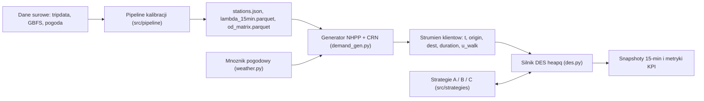
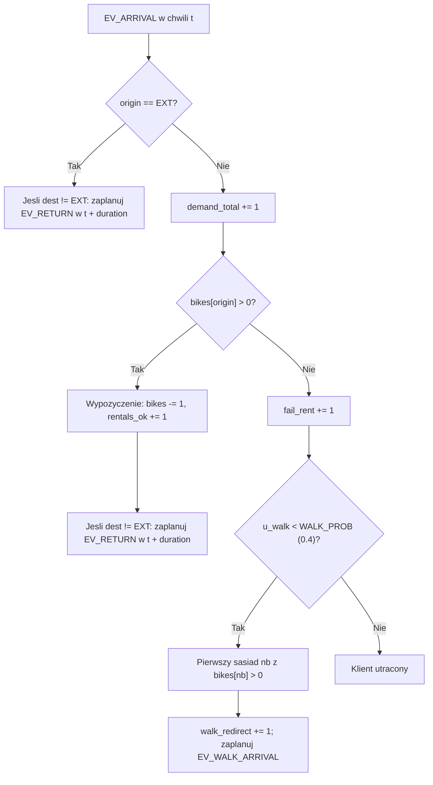

# Przegląd działania modelu symulacyjnego (`ssd-citibike-simulation`)

Dokument opisuje architekturę, podstawy matematyczne oraz logikę wykonawczą modelu symulacji dyskretnej (**DES**) i wieloagentowej (**ABM**) systemu rowerów miejskich Citi Bike na Dolnym Manhattanie.

---

## 1. Przegląd architektury modelu

Model odwzorowuje 24-godzinny cykl funkcjonowania sieci stacji rowerowych w horyzoncie `DAY_S = 86400 s` (od `00:00` do `24:00`), z dyskretnymi oknami czasowymi co `STEP_S = 900 s` (`SLOTS = 96` slotów po 15 minut). Składa się z czterech współpracujących warstw:

1. **Warstwa ETL i kalibracji ([scripts/01_prepare_data.py](file:///Users/bartekszota/Projects/ssd-citibike-simulation/scripts/01_prepare_data.py), `src/pipeline/`)** — buduje katalog stacji, oczyszcza dane historyczne, estymuje natężenia popytu $\lambda$ (z korektą cenzurowania GBFS), macierz przejść OD, rozkłady czasów przejazdu oraz mnożnik pogodowy.
2. **Generator strumienia klientów ([demand_gen.py](file:///Users/bartekszota/Projects/ssd-citibike-simulation/src/engine/demand_gen.py))** — zamienia skalibrowane tabele w deterministyczny (dla zadanego `seed`) ciąg zdarzeń przybycia klientów (**NHPP** + **Common Random Numbers**).
3. **Silnik zdarzeń dyskretnych DES ([des.py](file:///Users/bartekszota/Projects/ssd-citibike-simulation/src/engine/des.py))** — przetwarza zdarzenia w kolejce priorytetowej `heapq`, obsługuje wypożyczenia, zwroty, przekierowania piesze i rowerowe oraz nalicza wskaźniki KPI.
4. **Agenci furgonetek i strategie rebalansingu (`src/strategies/`)** — sterują flotą pojazdów (`VanAgent`) w trakcie zmiany dziennej w ramach trzech scenariuszy: bazowego **A**, reaktywnego **B** i predykcyjnego **C**.



Wszystkie główne stałe konfiguracyjne modelu znajdują się w pliku [config.py](file:///Users/bartekszota/Projects/ssd-citibike-simulation/src/common/config.py).

---

## 2. Kalibracja parametrów wejściowych (`src/pipeline/`)

### 2.1. Sieć stacji i przestrzeń modelu ([stations.py](file:///Users/bartekszota/Projects/ssd-citibike-simulation/src/pipeline/stations.py), [geo.py](file:///Users/bartekszota/Projects/ssd-citibike-simulation/src/common/geo.py))

* **Obszar analizy:** Stacje leżące wewnątrz wielokąta `MANHATTAN_POLYGON` (sprawdzane przez `in_area()`). Węzły spoza obszaru reprezentowane są wspólnym węzłem zewnętrznym `EXT = "EXT"`.
* **Normalizacja i deduplikacja:** Funkcja `build_stations()` ujednolica identyfikatory `short_name` (np. `"5470.1"` $\to$ `"5470.10"`), łączy dane przejazdów z danymi `station_information.json` z GBFS, scala duplikaty o tej samej nazwie (zapisując drugorzędne identyfikatory w polu `aliases`) i odfiltrowuje stacje mające mniej niż `MIN_MONTHLY_TRIPS = 30` przejazdów.
* **Pojemność i sąsiedzi:** Liczba doków `capacity` pochodzi z GBFS; w razie braku zastępowana jest medianą pojemności pozostałych stacji (lub wartością `20`). Dla każdej stacji wyznaczana jest lista sąsiadów `neighbors` w promieniu `NEIGHBOR_RADIUS_M = 500 m` (odległość `haversine_m`), posortowana od najbliższego sąsiada.
* **Metryka ruchu w mieście:** Do wyznaczania czasów marszu pieszych, objazdów rowerowych oraz tras furgonetek w silniku służy metryka manhattańska `manhattan_m()` z siatką ulic obróconą o `GRID_ANGLE_DEG = 29.0°`.

### 2.2. Czyszczenie i podział przejazdów ([trips.py](file:///Users/bartekszota/Projects/ssd-citibike-simulation/src/pipeline/trips.py))

Funkcja `clean_trips()` mapuje aliasy, wyznacza czas trwania `duration_s` i filtruje rekordy z okresu `MONTH_START`–`MONTH_END` (`2026-09-01`..`2026-09-30`):
* Zachowuje wyłącznie przejazdy mające przynajmniej jeden koniec w badanym obszarze (`o_in | d_in`). Końce poza obszarem otrzymują etykietę `EXT`.
* Odrzuca przejazdy o czasie poza `[0, MAX_DURATION_S]` (`14400 s` = 4 h) oraz pętle `origin == dest` krótsze niż `MIN_DURATION_S = 60 s`.
* Dzieli dane na:
  * **typ dnia (`day_type`):** `"weekend"` dla sobót, niedziel oraz świąt ze zbioru `HOLIDAYS` (np. `2026-09-07`), w przeciwnym razie `"weekday"`;
  * **podział czasowy (`split`):** `"calib"` dla `date < VALID_START` (`2026-09-24`) oraz `"valid"` dla Tygodnia 4 (`2026-09-24..30`).

### 2.3. Niejednorodny Proces Poissona i korekta cenzurowania ([demand.py](file:///Users/bartekszota/Projects/ssd-citibike-simulation/src/pipeline/demand.py))

Dla każdej stacji (oraz węzła `EXT`), typu dnia i 15-minutowego slotu (`0..95`) funkcja `estimate_lambda()` wyznacza na zbiorze `calib`:

1. **Surową intensywność wypożyczeń i zwrotów** [zdarzeń/h]:
   $$\lambda_{\text{raw}}(i, d, s) = \frac{\text{rent\_count}(i, d, s)}{n_{\text{days}}(d) \cdot 0.25}, \qquad \text{return\_rate}(i, d, s) = \frac{\text{return\_count}(i, d, s)}{n_{\text{days}}(d) \cdot 0.25}$$
2. **Korektę cenzurowania popytu (`exposure_frac`):** Jeśli w `data/raw/gbfs_status/` dostępnych jest co najmniej `MIN_GBFS_DAYS = 2` dni pomiarów GBFS, funkcja `exposure_from_gbfs()` oblicza średni ułamek czasu, w którym na stacji znajdował się co najmniej jeden dostępny rower (`num_bikes_available > 0`). Wartość jest przycinana do przedziału `[MIN_EXPOSURE, 1.0]` (`[0.2, 1.0]`; dla `EXT` przyjmuje zawsze `1.0`).
3. **Skorygowaną intensywność popytu:**
   $$\lambda(i, d, s) = \frac{\lambda_{\text{raw}}(i, d, s)}{\text{exposure\_frac}(i, d, s)}$$

Pozwala to odtworzyć utajony popyt na stacjach, które w danych historycznych bywały puste i nie mogły rejestrować kolejnych wypożyczeń.

### 2.4. Macierz przejść OD i rozkład czasu przejazdu ([od.py](file:///Users/bartekszota/Projects/ssd-citibike-simulation/src/pipeline/od.py))

* **Prawdopodobieństwa kierunków (`estimate_od`):** Dla każdej godziny `hour` (`0..23`) i stacji źródłowej prawdopodobieństwo wyboru stacji docelowej jest wygładzane metodą empiryczną Bayesowską w kierunku całodobowego profilu tej relacji $p_{\text{day}}$:
  $$P(\text{dest} \mid \text{origin}, \text{day\_type}, \text{hour}) = \frac{n_{\text{trips}} + \alpha \cdot p_{\text{day}}}{n_{\text{origin}, h} + \alpha}, \qquad \alpha = \text{OD\_ALPHA} = 5.0$$
* **Rozkład log-normalny czasu przejazdu (`duration_params`):** Czas trwania modelowany jest rozkładem log-normalnym $\ln T \sim \mathcal{N}(\mu, \sigma^2)$ estymowanym na parach `(origin_id, dest_id)` (po przycięciu `duration_s` do co najmniej `30 s`). Jeśli para ma mniej niż `OD_MIN_DUR_SAMPLES = 5` obserwacji, stosowany jest fallback:
  * statystyki zbiorcze dla wjazdów z `EXT`, wyjazdów do `EXT` albo pętli `origin == dest`,
  * dla par między różnymi stacjami wewnętrznymi: $\mu_{\text{fb}} = \ln\left(\max\left(\frac{\text{manhattan\_m}}{12.0 / 3.6},\ 120.0\right)\right)$ oraz $\sigma_{\text{fb}} = \text{FALLBACK\_SIGMA} = 0.35$.
  * odchylenie standardowe `dur_sigma` przycinane jest od dołu do `MIN_SIGMA = 0.05`.

### 2.5. Mnożnik pogodowy ([weather.py](file:///Users/bartekszota/Projects/ssd-citibike-simulation/src/pipeline/weather.py))

Funkcja `weather_multiplier()` zwraca `1.0` dla pogody suchej (`"dry"`). Dla `"rain"` funkcja `estimate_rain_multiplier()` porównuje w zbiorze kalibracyjnym (w godzinach `6..21`) medianę stosunku średniej liczby przejazdów w godzinach deszczowych (`precip_mm >= 0.5`) do bezdeszczowych w obrębie tych samych `(day_type, hour)`. Wynik przycinany jest do przedziału `[0.55, 0.90]` (a w przypadku braku co najmniej 3 godzin deszczowych przyjmowana jest wartość `DEFAULT_RAIN_MULT = 0.72`).

---

## 3. Generator strumienia klientów — NHPP i CRN ([demand_gen.py](file:///Users/bartekszota/Projects/ssd-citibike-simulation/src/engine/demand_gen.py))

Generator tworzy przed uruchomieniem symulacji kompletną, posortowaną chronologicznie listę zdarzeń przybycia klientów na podstawie `DemandTable`:

1. **Budowa tabeli popytu (`build_demand_table`):** Wczytuje wiersze dla wybranego `day_type`, mnoży intensywności $\lambda$ przez `weather_mult`, wyznacza maksimum dobowe $\lambda_{\max}(i) = \max_s \lambda(i, s)$ dla każdego źródła oraz buduje dystrybuanty skumulowane `od_cdf[origin][hour]`.
2. **Przerzedzanie Lewisa–Shedlera (`_thin_station`):** Dla każdego źródła $i$ (stacje `0..N-1` oraz `EXT`) generuje kandydackie czasy przybycia z jednorodnego procesu Poissona o intensywności $\lambda_{\max}(i) / 3600$, a następnie akceptuje każde przybycie w slocie $s = \min(\lfloor t / 900 \rfloor, 95)$ z prawdopodobieństwem $\lambda(i, s) / \lambda_{\max}(i)$.
3. **Atrybuty podróży (`generate_customer_stream`):** Dla każdego zaakceptowanego przybycia:
   * losuje stację docelową `dest` metodą odwróconej dystrybuanty (`np.searchsorted`) z `od_cdf[origin][hour]`,
   * losuje czas przejazdu $\text{dur} = \text{clip}(\text{rint}(\exp(\mu + \sigma Z)),\ 30,\ 14400)$ gdzie $Z \sim \mathcal{N}(0, 1)$,
   * przypisuje losową zmienną `u_walk ~ U(0, 1)` decydującą o ewentualnym podejściu do sąsiedniej stacji,
   * sortuje wszystkie przybycia leksykograficznie po `(t, origin)`.

> **Common Random Numbers (CRN):** Ponieważ strumień klientów generowany jest wyłącznie z `(DemandTable, seed)`, porównywanie scenariuszy A, B i C przy tym samym `seed`, `day_type` i `weather` odbywa się na **identycznym strumieniu przychodzących klientów**, co eliminuje wariancję między scenariuszami.

---

## 4. Silnik zdarzeń dyskretnych DES ([des.py](file:///Users/bartekszota/Projects/ssd-citibike-simulation/src/engine/des.py))

Klasa `SimulationEngine` zarządza stanem wszystkich $N$ stacji (`bikes`, `capacity`, `neighbors`, macierzą odległości `dist_m`) i wykonuje pętlę zdarzeń opartą o kopiec binarny `heapq` w przedziale `t ∈ [0, 86400]`.

### 4.1. Inicjalizacja i typy zdarzeń

* W chwili `t = 0` każda stacja otrzymuje liczbę rowerów `bikes[i] = clip(rint(capacity[i] * init_fill), 0, capacity[i])` (domyślnie `INIT_FILL = 0.5`).
* Kolejka obsługuje 7 typów zdarzeń (w kolejności priorytetu przy równym czasie `t`):
  * `EV_SNAPSHOT (0)` — cyklicznie co `900 s` (`t = 0, 900, ..., 86400`, łącznie 97 klatek); wywołuje `strategy.on_tick(sim, t)` i zapisuje ramkę stanu.
  * `EV_DISPATCH (1)` — zdarzenia zmiany furgonetek (start `06:00`, koniec `22:00`).
  * `EV_VAN_SERVICE (2)` — przyjazd furgonetki na stację lub zakończenie jej załadunku/rozładunku.
  * `EV_RETURN (3)` — planowany zwrot roweru na stacji docelowej.
  * `EV_RETURN_REDIR (4)` — ponowiona próba zwrotu po przekierowaniu z pełnej stacji.
  * `EV_WALK_ARRIVAL (5)` — dotarcie pieszego klienta do sąsiedniej stacji po nieudanym wypożyczeniu.
  * `EV_ARRIVAL (6)` — pierwotne przybycie klienta ze strumienia NHPP.

### 4.2. Przepływ obsługi klienta (wypożyczenia i zwroty)



* **Przyjazd z zewnątrz (`origin == EXT_IDX`):** Nie zwiększa licznika `demand_total`; jeśli `dest != EXT_IDX`, planuje zwrot `EV_RETURN` na stacji docelowej po czasie `duration`.
* **Przekierowanie piesze (`_handle_arrival` $\to$ `_handle_walk_arrival`):** Przy pustej stacji początkowej klient z prawdopodobieństwem `WALK_PROB = 0.4` sprawdza listę `neighbors[origin]` (w kolejności rosnącej odległości do `500 m`). Jeśli któryś sąsiad ma rower (`bikes[nb] > 0`), klient idzie tam w czasie `max(15, round(dist_m / WALK_SPEED_MPS))` przy `WALK_SPEED_MPS = 1.35 m/s`. Jeśli po dotarciu rower nadal jest dostępny, wypożycza go; w przeciwnym razie rezygnuje (bez naliczania drugiego `fail_rent`).
* **Obsługa zwrotu (`_handle_return`):**
  * Jeśli `dest == EXT_IDX`, rower opuszcza obszar modelu (brak zdarzenia zwrotu).
  * Jeśli na stacji jest wolny dok (`bikes[dest] < capacity[dest]`), rower jest zwracany (`+1`).
  * Gdy stacja jest pełna, przy pierwszej próbie (`retry == 0`) inkrementowany jest `fail_return`. Dopóki `retry < MAX_RETURN_RETRIES` (`3`), rowerzysta przekierowywany jest rowerem (`BIKE_SPEED_MPS = 12/3.6 m/s`) do pierwszego sąsiada z wolnym dokiem (`min 15 s`), a gdy wszyscy sąsiedzi są pełni — do najbliższej stacji w całej sieci z wolnym dokiem (`min 30 s`).

### 4.3. Metryki i rejestracja czasu niedostępności

Przy każdej zmianie liczby rowerów (`change_bikes`) oraz na końcu doby (`t = 86400`) metoda `_accrue_station_time()` zlicza dokładny czas (z podziałem na granice pełnych godzin), przez jaki stacja była pusta (`bikes[i] == 0`) lub pełna (`bikes[i] >= capacity[i]`), sumując go do `empty_station_min` i `full_station_min`. Każda zmiana wywołuje też hak `strategy.on_station_change(self, i, t_now)`.

---

## 5. Model agentów furgonetek i strategie rebalansingu (`src/strategies/`)

Wszystkie strategie dziedziczą po `BaseStrategy` ([base.py](file:///Users/bartekszota/Projects/ssd-citibike-simulation/src/strategies/base.py)). Furgonetki reprezentowane są przez obiekty `VanAgent` o pojemności `van_capacity` (domyślnie `25` rowerów) i jednym ze stanów: `"off"`, `"idle"`, `"driving"`, `"servicing"`.

### 5.1. Scenariusz A — Baseline ([base.py](file:///Users/bartekszota/Projects/ssd-citibike-simulation/src/strategies/base.py))

`ScenarioA` wymusza `n_vans = 0`. W trakcie doby nie działają żadne furgonetki — system ewoluuje wyłącznie pod wpływem strumienia klientów i naturalnych przekierowań.

### 5.2. Scenariusz B — Strategia Reaktywna ([reactive.py](file:///Users/bartekszota/Projects/ssd-citibike-simulation/src/strategies/reactive.py))

`ScenarioB` reaguje na **bieżące** przekroczenia progów zapełnienia `thr_low = 0.1` oraz `thr_high = 0.9`:

* **Flota i zmiana robocza:** $N$ furgonetek (domyślnie `4`) rozstawianych jest na starcie równomiernie po randze szerokości geograficznej `sim.lat`. Praca trwa w oknie `VAN_SHIFT_START_S = 21600` (`06:00`) do `VAN_SHIFT_END_S = 79200` (`22:00`).
* **Fizyka przejazdu i obsługi:**
  * Prędkość jazdy (`van_speed_mps`): w dni robocze w szczycie porannym (`07:00–10:00`) i popołudniowym (`16:00–19:00`) wynosi `VAN_SPEED_PEAK_MPS = 11.0 / 3.6 m/s` (`11 km/h`), poza szczytem i w weekendy `VAN_SPEED_OFFPEAK_MPS = 18.0 / 3.6 m/s` (`18 km/h`).
  * Czas przejazdu to `max(60, round(dist_m / speed))` po metryce manhattańskiej; kurs nie jest wysyłany, jeśli `t_arr + VAN_SERVICE_BASE_S > VAN_SHIFT_END_S`.
  * Czas serwisu na stacji wynosi `120 + 8 * qty` sekund (`VAN_SERVICE_BASE_S + VAN_SERVICE_PER_BIKE_S * qty`), lub `30 s` jeśli nie przeniesiono żadnego roweru.
* **Wyzwalanie dyspozytora (`_try_dispatch`):** Odbywa się co 15 minut w `on_tick`, po zakończeniu serwisu (`_on_finish_service`) oraz natychmiast w `on_station_change`, gdy któraś stacja osiągnie `fill <= thr_low` lub `fill >= thr_high` i istnieje wolna furgonetka (`"idle"`).
* **Dobór par `pickup -> dropoff`:**
  * Jeśli furgonetka jest pusta (`load == 0`), interwencja następuje tylko wtedy, gdy w sieci istnieje niezaadresowany alarm pustki (`fill <= thr_low`) lub przepełnienia (`fill >= thr_high`).
  * Stacja biorcy (`dst_idx`) wybierana jest najpierw spośród alarmów pustki (lub stacji `< 45%` z min. 5 wolnymi dokami przy alarmie przepełnienia) wg wyniku $\frac{(\lambda_{\text{out}} + 1)(1 - \text{fill})}{d_{\text{km}} + 0.4}$.
  * Stacja dawcy (`src_idx`) wybierana jest spośród alarmów przepełnienia (lub stacji $\ge 55\%$ z nadwyżką $\ge 4$ rowerów ponad `45%` pojemności) wg wyniku $\frac{(\lambda_{\text{in}} + 1) \cdot \max(\text{fill} - 0.45, 0.05)}{d_{\text{cur} \to \text{src}} + 0.5 d_{\text{src} \to \text{dst}} + 0.35}$.
  * Stacje będące aktualnym celem innej furgonetki są blokowane w zbiorach `_reserved_pickup` i `_reserved_dropoff`.
* **Załadunek i rozładunek (`_on_arrive_station`):** Przy odbiorze (`pickup`) zostawia się na stacji ok. `45%` pojemności; przy dostawie (`dropoff`) uzupełnia się stację maksymalnie do `85%` pojemności (chyba że naładowana furgonetka nie ma innej opcji niż oddać do wolnych doków).

### 5.3. Scenariusz C — Strategia Predykcyjna ([predictive.py](file:///Users/bartekszota/Projects/ssd-citibike-simulation/src/strategies/predictive.py))

`ScenarioC` dziedziczy mechanikę floty z `ScenarioB`, ale decyzje podejmuje z wyprzedzeniem na podstawie prognozy w kroczącym oknie czasowym `horizon_min` (domyślnie `HORIZON_MIN_DEFAULT = 60 min`):

* **Prognoza bilansu netto (`_forecast_window`):** Całkuje skalibrowane intensywności wypożyczeń $\lambda_{\text{out}}$ i zwrotów $\lambda_{\text{in}}$ na przedziale $[t, \min(86400, t + H)]$ z uwzględnieniem przejść między 15-minutowymi slotami, wyliczając oczekiwany odpływ `exp_out`, napływ `exp_in` oraz zmianę netto `net_delta = exp_in - exp_out`.
* **Wcześniejsze wyzwalanie i alarmy predykcyjne:**
  * `on_station_change` wywołuje dyspozytora już przy `fill <= thr_low + 0.05` lub `fill >= thr_high - 0.05`.
  * Na podstawie przewidywanego stanu `pred_bikes = clip(bikes + net_delta, 0, cap)` obliczane są przewidywane niedobory `shortage` (poniżej `thr_low + 0.04`) i przepełnienia `overflow` (powyżej `thr_high - 0.04`). Do interwencji kwalifikują się zarówno stacje już w alarmie, jak i zagrożone w horyzoncie $H$ (`shortage >= 2.5` lub `overflow >= 2.5`).
* **Łączna optymalizacja par `pickup–dropoff`:**
  * Dla 25 najlepszych kandydatów dawców (`benefit_s`) i biorców (`benefit_d`) wyznaczana jest macierz łącznego zysku pary ważona przewidywaną wielkością transferu `qty_factor`:
    $$\text{pair\_score}(s, d) = \frac{(\text{benefit}_s + \text{benefit}_d) \cdot \text{qty\_factor}}{d_{\text{cur} \to s} + 0.65\,d_{s \to d} + 0.45}$$
* **Adaptacyjne progi na stacji:**
  * Przy odbiorze (`pickup`) wyliczany jest dynamiczny zapas bezpieczny `safe_keep` — mniejszy na stacjach spodziewających się silnego napływu (`net_delta > 0`), większy przed falą wypożyczeń (`net_delta < 0`), zawsze ograniczony do `[max(4, 0.20*cap), 0.65*cap]` przy doborze i `[0.22*cap, 0.60*cap]` przy realizacji.
  * Przy dostawie (`dropoff`) limit napełnienia rośnie z `85%` do `90%` dla stacji z przewidywanym odpływem netto (`st_net < -2.0`), a mała końcówka ładunku ($\le 5$ rowerów) może zostać rozładowana w całości, jeśli nie przekroczy progu `thr_high`.

---

## 6. Uruchamianie, wyjścia i walidacja modelu

### 6.1. Uruchamianie pojedynczej symulacji ([02_run_simulation.py](file:///Users/bartekszota/Projects/ssd-citibike-simulation/scripts/02_run_simulation.py))

```bash
uv run python scripts/02_run_simulation.py --scenario C --n-vans 4 --seed 1 --day-type weekday --weather dry --init-fill 0.5 --horizon-min 60
```

Wyniki zapisywane są w formatach zwalidowanych przez [contracts.py](file:///Users/bartekszota/Projects/ssd-citibike-simulation/src/common/contracts.py):
* `data/outputs/snapshots/{scenario}_n{n_vans}_s{seed}.json` — 97 klatek stanu stacji (`bikes`, `fail_rent`, `fail_return`), pozycje i ładunek furgonetek (`vans`), odcinki tras `van_legs` oraz kumulatywne KPI.
* `data/outputs/metrics/metrics_runs.csv` — metryki zagregowane dla całego przebiegu (`demand_total`, `rentals_ok`, `fail_rent`, `fail_return`, `walk_redirect`, `empty_station_min`, `full_station_min`, `van_km`, `bikes_moved`).
* `data/outputs/metrics/metrics_hourly.csv` — rozbicie powyższych metryk na 24 godziny doby.

### 6.2. Walidacja dwuetapowa ([validation.py](file:///Users/bartekszota/Projects/ssd-citibike-simulation/src/viz/validation.py))

Poprawność skalibrowanego modelu weryfikowana jest na rozłącznym zbiorze testowym (Tydzień 4: `2026-09-24..30`, `split == "valid"`):
1. **Etap 1 (`validate_stage1_demand_and_durations`):** Porównanie symulowanych profili godzinowych wypożyczeń i zwrotów (w dniach suchych, deszczowych i ważonym miksie Tygodnia 4) z danymi rzeczywistymi (MAE, RMSE, MAPE, WAPE, korelacja Pearsona $r$) oraz porównanie rozkładów czasów przejazdu testem Kołmogorowa–Smirnowa (K-S).
2. **Etap 2 (`EmpiricalRelocationStrategy`, `reconstruct_gbfs_and_hidden_relocation`):** Odtworzenie historycznej relokacji operatora z różnicy między stanem GBFS a bilansem wypożyczeń/zwrotów z CSV i weryfikacja odtwarzania krzywych zapełnienia stacji w ciągu doby.
