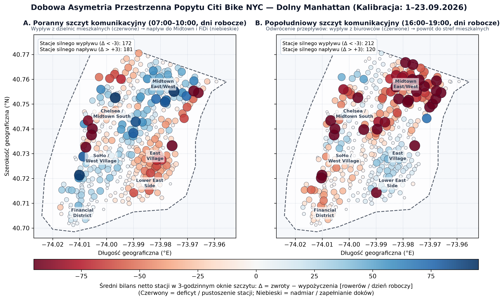
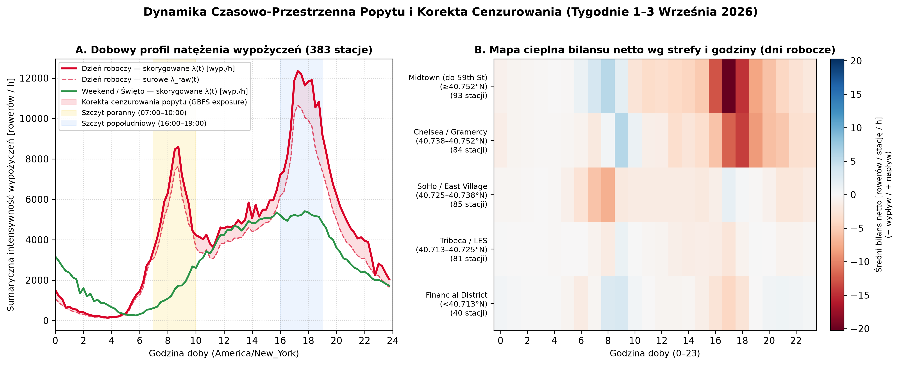
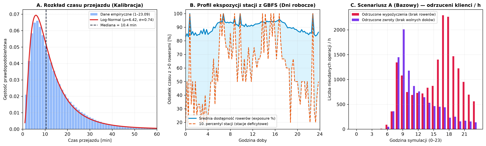

# Symulacja Dyskretna i Optymalizacja Relokacji Rowerów Miejskich Citi Bike NYC (Dolny Manhattan)

**Metodyka:** Discrete Event Simulation (DES) + Agent-Based Modeling (ABM)  
**Obszar badań:** Dolny Manhattan poniżej 59th Street ($N = 383$ stacje, $22\,401$ doków)  
**Okres danych empirycznych:** Wrzesień 2026 (`2026-09`, $4\,982\,855$ surowych przejazdów NYC; $2\,685\,269$ przejazdów związanych z badanym obszarem)

---

## Rozdział 1. Wstęp, Cel Badań i Hipotezy Badawcze

### 1.1. Sformułowanie problemu inżynierskiego
Systemy rowerów miejskich czwartej generacji, takie jak nowojorski **Citi Bike**, zmagają się z fundamentalnym problemem strukturalnej asymetrii popytu w cyklu dobowym. W dni robocze poranna fala dojazdów do pracy (*commuting*) powoduje gwałtowny odpływ rowerów z dzielnic mieszkaniowych (Upper/Lower East Side, East Village, Greenwich Village) oraz jednoczesne zapełnianie stacji dokujących w dzielnicach biurowych i finansowych (Midtown oraz Financial District). Prowadzi to do dwóch dualnych zjawisk degradujących poziom obsługi (*Level of Service*):
1. **Pustoszenia stacji (*starvation*, $B_i(t) = 0$):** Klient przybywający na stację nie może wypożyczyć roweru (`fail_rent`), co zmusza go do pieszego poszukiwania sąsiedniej stacji lub rezygnacji z usługi.
2. **Przepełnienia stacji (*congestion / blocking*, $B_i(t) = C_i$):** Użytkownik kończący przejazd nie znajduje wolnego doku (`fail_return`) i musi krążyć między sąsiednimi stacjami w poszukiwaniu miejsca zwrotu.

W popołudniowym szczycie komunikacyjnym (16:00–19:00) wektor przepływu ulega odwróceniu: stacje w Midtown i Financial District błyskawicznie pustoszeją, natomiast stacje w dzielnicach mieszkalnych ulegają zablokowaniu. Operator systemu dysponuje flotą $N$ furgonetek relokacyjnych o pojemności $K$ rowerów każda, które w ciągu dnia przewożą rowery między stacjami przepełnionymi a deficytowymi.

### 1.2. Cel pracy
Celem pracy jest zbudowanie skalibrowanego matematycznie symulatora zdarzeń dyskretnych (**DES**) połączonego z modelowaniem agentowym (**ABM**) dla sieci 383 stacji dolnego Manhattanu, a następnie porównanie trzech strategii sterowania flotą furgonetek:
- **Scenariusz A (Bazowy / Nocny Reset):** Brak dziennej relokacji interwencyjnej ($N = 0$ furgonetek w godzinach 06:00–22:00); jedyną operacją jest nocne przywrócenie zapełnienia stacji do poziomu docelowego $\alpha_0 = 50\%$.
- **Scenariusz B (Reaktywny / Progowy):** Dyspozytor wysyła furgonetki wyłącznie w reakcji na przekroczenie progów alarmowych zapełnienia stacji ($B_i(t)/C_i < 10\%$ lub $B_i(t)/C_i > 90\%$).
- **Scenariusz C (Predykcyjny / Wyprzedzający):** Dyspozytor co 15 minut prognozuje bilans netto każdej stacji w horyzoncie czasowym $H$ (np. $60\text{ min}$) na podstawie wyestymowanych intensywności niejednorodnego procesu Poissona $\lambda_{\text{out}, i}(t)$ oraz $\lambda_{\text{in}, i}(t)$, relokując rowery przed wystąpieniem szczytu.

### 1.3. Hipotezy badawcze (H0–H6)

| Kod | Hipoteza badawcza | Testowana metryka / kryterium weryfikacji |
| :--- | :--- | :--- |
| **H0** | **Walidacja modelu:** Skalibrowany na Tygodniach 1–3 symulator wiernie odtwarza dobowy profil popytu oraz rozkład czasów przejazdu w niezależnym zbiorze walidacyjnym (Tydzień 4: 24–30.09). | Korelacja profili godzinowych $r > 0.95$, błąd względny MAPE $< 15\%$, test Kołmogorowa–Smirnowa dla czasów jazdy. |
| **H1** | **Skuteczność relokacji reaktywnej:** Wprowadzenie dziennej relokacji reaktywnej (Scenariusz B) istotnie statystycznie redukuje łączną liczbę nieobsłużonych klientów (`fail_rent + fail_return`) względem Scenariusza A. | Sparowany test t-Studenta / Wilcoxona na 30 replikacjach CRN ($\alpha = 0.05$). |
| **H2** | **Przewaga strategii predykcyjnej:** Przy tej samej wielkości floty ($N = 4$ vany) strategia predykcyjna (Scenariusz C) osiąga istotnie niższy odsetek odrzuconych klientów i krótszy czas niedostępności stacji niż strategia reaktywna (Scenariusz B). | Sparowany test dla różnicy nieobsłużonego popytu oraz sumy `empty_station_min + full_station_min`. |
| **H3** | **Efektywność kosztowa (krańcowa użyteczność kilometra):** Strategia predykcyjna C zapewnia wyższą liczbę uratowanych operacji (wypożyczeń i zwrotów) w przeliczeniu na 1 przejechany kilometr furgonetki niż strategia B. | Wskaźnik $\eta = \Delta \text{obsłużeni} / \text{van\_km}$ [klientów / km]. |
| **H4** | **Prawo malejących przychodów skali floty:** Zależność jakości obsługi od liczby furgonetek $N \in \{1, 2, 4, 6, 8\}$ jest silnie nieliniowa (wklęsła) i wykazuje wyraźny punkt nasycenia Pareto. | Analiza przyrostów krańcowych $\Delta \text{LoS} / \Delta N$ na krzywej Pareto. |
| **H5** | **Substytucja wielkości floty inteligencją algorytmu:** Mniejsza flota sterowana predykcyjnie (np. $N = 4$ vany w Scenariuszu C) przewyższa lub dorównuje większej flocie sterowanej reaktywnie ($N = 6$ vanów w Scenariuszu B). | Porównanie przedziałów ufności 95% dla $(C, N=4)$ vs $(B, N=6)$. |
| **H6** | **Wrażliwość na warunki atmosferyczne:** Opady deszczu ($\ge 0.5\text{ mm/h}$) istotnie obniżają popyt całkowity i zmniejszają minimalną liczebność floty niezbędną do utrzymania odsetka odrzuceń poniżej progu 5%. | Analiza scenariuszowa `weather = dry` vs `weather = rain`. |

---

## Rozdział 2. Dane Pomiarowe, Filtracja Przestrzenna i Analiza Eksploracyjna (EDA)

### 2.1. Źródła danych i podział czasowy
W badaniu wykorzystano trzy komplementarne strumienie danych:
1. **Historyczne dane przejazdów (*Citi Bike System Data*, `2026-09`):** Pięć plików CSV obejmujących pełny wrzesień 2026 r. ($4\,982\,855$ surowych rekordów przejazdów w całym systemie NYC).
2. **Strumień statusów stacji na żywo (*GBFS `station_information.json` oraz `station_status.json`*):** Zautomatyzowany kolektor pobierający co 15 minut stan dostępnych rowerów i wolnych doków (388 migawek Parquet na gałęzi `data-gbfs`), wykorzystywany do wyznaczenia pojemności stacji oraz profilu ekspozycji `exposure_frac` na potrzeby korekty cenzurowania popytu.
3. **Dane meteorologiczne (*Open-Meteo / NOAA Central Park*):** Godzinowe pomiary temperatury (`temp_c`) oraz wysokości opadu (`precip_mm`) zapisane w `data/external/weather_hourly.csv`.

Zgodnie z metodyką walidacji krzyżowej w czasie, miesiąc referencyjny podzielono na dwa rozłączne podzbiory:
- **Okres kalibracji (`split = "calib"`, 1–23 września 2026):** 15 dni roboczych (`weekday`) oraz 8 dni weekendowych i świątecznych (`weekend`, z dniem *Labor Day* `2026-09-07` wliczonym do kategorii weekendowej).
- **Okres walidacji (`split = "valid"`, 24–30 września 2026, Tydzień 4):** 5 dni roboczych oraz 2 dni weekendowe służące do weryfikacji hipotezy **H0**.

### 2.2. Filtracja przestrzenna wielokątem Dolnego Manhattanu i węzeł zewnętrzny `EXT`
Zastosowanie zwykłego prostokąta ograniczającego (*bounding box* `lat 40.7000–40.7650, lon -74.0200 do -73.9600`) jest obarczone błędem geometrycznym, ponieważ siatka ulic Manhattanu jest obrócona o kąt $\theta = 29^\circ$ względem osi północ–południe, przez co prostokąt zahacza przez East River o stacje na Brooklynie (DUMBO, Brooklyn Heights, Williamsburg). W celu wyeliminowania stacji zza rzeki zastosowano 19-wierzchołkowy wielokąt `MANHATTAN_POLYGON` precyzyjnie wycinający obszar wyspy Manhattan poniżej 59th Street.

Po normalizacji identyfikatorów `short_name` (uzupełnienie uciętych zer końcowych typu `"5470.1" -> "5470.10"`), scaleniu duplikatów po nazwie stacji (`aliases`) oraz odrzuceniu stacji efemerycznych ($<30$ przejazdów/miesiąc) i anomalii czasowych (przejazdy $<60\text{ s}$ na tę samą stację oraz $>4\text{ h}$), otrzymano poniższe parametry sieci:

| Parametr sieci i zbioru danych | Wartość wyliczona (`2026-09`) |
| :--- | ---: |
| Liczba aktywnych stacji w wielokącie Dolnego Manhattanu ($N$) | **383 stacje** |
| Łączna pojemność doków w badanym obszarze ($\sum C_i$) | **22 401 doków** |
| Średnia / mediana pojemności stacji | **58,5 / 56 doków** (372 stacje bezpośrednio z GBFS) |
| Średnia liczba stacji sąsiednich w promieniu pieszego dojścia ($R \le 500\text{ m}$) | **11,8 stacji** |
| Liczba wyczyszczonych przejazdów powiązanych z obszarem | **2 685 269 przejazdów** |
| — w tym zbiór kalibracyjny (`1–23.09`: 15 dni roboczych / 8 weekendowych) | **2 183 859** (`1 642 239` rob. / `541 620` week.) |
| — w tym zbiór walidacyjny (`24–30.09`, Tydzień 4) | **501 410** (`455 243` rob. / `46 167` week.) |
| Udział przejazdów wjeżdżających z węzła zewnętrznego (`origin = EXT`) | **12,46%** |
| Udział przejazdów wyjeżdżających poza obszar (`dest = EXT`) | **12,69%** |

Wszystkie przejazdy przekraczające północną granicę 59th Street lub mosty na East River są reprezentowane przez wirtualny węzeł zewnętrzny **`"EXT"`** o nieskończonej pojemności, co zapewnia pełne domknięcie bilansu masy rowerów wpływających i wypływających z dolnego Manhattanu.

### 2.3. Analiza Eksploracyjna Danych (EDA): Asymetria przestrzenna i dobowa

Kluczowym dowodem empirycznym uzasadniającym konieczność relokacji rowerów jest analiza przestrzennego rozkładu bilansu netto stacji $\Delta_i = \text{zwroty}_i - \text{wypożyczenia}_i$ w godzinach porannego i popołudniowego szczytu komunikacyjnego (Rysunek 1).

*Rysunek 1. Dobowa asymetria przestrzenna popytu w dni robocze na dolnym Manhattanie (okres kalibracji 1–23.09.2026). Panel A: szczyt poranny (07:00–10:00). Panel B: szczyt popołudniowy (16:00–19:00).*

Z Rysunku 1 oraz danych zagregowanych w Tabeli 1 wynikają jednoznaczne wnioski:
1. **Szczyt poranny (07:00–10:00):** Aż **172 stacje** wykazują silny ujemny bilans netto ($\Delta < -3$ rowery w ciągu 3 godzin), szczególnie w pasmie mieszkaniowym East Village, Lower East Side, West Village oraz wzdłuż korytarzy nabrzeżnych. Jednocześnie **181 stacji** w rejonie Midtown East/West (Park Ave, Broadway, 9 Ave / Penn Station) oraz Financial District wykazuje gwałtowny napływ netto przekraczający często $+80\dots+129$ rowerów na stację, co bez udziału furgonetek błyskawicznie blokuje możliwość zwrotu roweru.
2. **Szczyt popołudniowy (16:00–19:00):** Obraz ulega niemal lustrzanemu odwróceniu (**212 stacji** silnego wypływu i **120 stacji** napływu). Stacje biurowe wokół Park Ave, 40–51 St oraz 9 Ave tracą po $120\dots 200$ rowerów netto w ciągu trzech godzin.

**Tabela 1.** Stacje o najbardziej skrajnym porannym deficycie oraz porannym nadmiarze rowerów w dni robocze (07:00–10:00).

| Typ anomalii rano | ID stacji | Nazwa stacji | Pojemność $C_i$ | Bilans poranny (07–10) $\Delta_{\text{AM}}$ | Bilans popołudniowy (16–19) $\Delta_{\text{PM}}$ |
| :--- | :--- | :--- | ---: | ---: | ---: |
| **Poranny deficyt** | `5886.13` | E 20 St & FDR Dr (Stuyvesant Town) | 56 | **−245,9** | −172,8 |
| **Poranny deficyt** | `5997.10` | W 12 St & Hudson St (West Village) | 45 | **−164,6** | −202,3 |
| **Poranny deficyt** | `6115.06` | Hudson St & W 13 St | 56 | **−140,0** | −408,0 |
| **Poranny deficyt** | `6575.03` | E 51 St & 2 Ave | 56 | **−110,8** | −185,6 |
| **Poranny deficyt** | `5847.10` | Greenwich St & Christopher St | 74 | **−109,4** | −25,7 |
| **Poranny nadmiar** | `6492.08` | 9 Ave & W 33 St (Penn Station / Midtown) | 94 | **+129,0** | −148,4 |
| **Poranny nadmiar** | `6584.12` | E 47 St & Park Ave (Midtown East) | 81 | **+105,6** | −149,4 |
| **Poranny nadmiar** | `5470.10` | Greenwich St & Hubert St (Tribeca) | 35 | **+93,4** | −102,4 |
| **Poranny nadmiar** | `6173.08` | Broadway & W 25 St (Flatiron) | 109 | **+85,1** | −80,4 |
| **Poranny nadmiar** | `6432.11` | E 40 St & Park Ave (Grand Central) | 123 | **+82,3** | −124,8 |

*Rysunek 2. Panel A: Porównanie dobowego profilu intensywności wypożyczeń dla dni roboczych (surowe $\lambda_{\text{raw}}$ vs skorygowane o cenzurowanie $\lambda$) oraz weekendów. Panel B: Mapa cieplna średniego godzinowego bilansu netto stacji w pięciu strefach szerokości geograficznej dolnego Manhattanu.*

Na Rysunku 2A widoczna jest fundamentalna różnica między dwuszczytowym profilem dnia roboczego (poranny pik ok. $8\,600\text{ wyp./h}$ o godz. 08:45 oraz potężny szczyt popołudniowy przekraczający $12\,300\text{ wyp./h}$ o godz. 17:15) a łagodnym, jednomodalnym profilem weekendowym (maksimum ok. $5\,400\text{ wyp./h}$ między 13:00 a 18:00). Rysunek 2B potwierdza, że w strefie Midtown ($\ge 40.752^\circ\text{N}$) oraz Chelsea/Gramercy ($40.738\text{–}40.752^\circ\text{N}$) w godzinach 07:00–10:00 dominuje silny napływ netto (kolor niebieski), natomiast między 16:00 a 19:00 następuje gwałtowny drenaż stacji sięgający średnio $-20\text{ rowerów/stację/h}$ (kolor ciemnoczerwony).

---

## Rozdział 3. Model Matematyczny i Kalibracja Procesów Stochastycznych

### 3.1. Niejednorodny Proces Poissona (NHPP) i korekta cenzurowania popytu
Strumień klientów zgłaszających chęć wypożyczenia roweru na stacji $i \in \{1, \dots, N, \text{EXT}\}$ w dniu typu $d \in \{\text{weekday}, \text{weekend}\}$ modelujemy jako **Niejednorodny Proces Poissona (NHPP)** o przedziałami stałej intensywności $\lambda_{i, d}(s)$ w 96 oknach 15-minutowych ($s \in \{0, \dots, 95\}$, $\Delta t = 0.25\text{ h}$).

Surowy estymator historyczny $\lambda_{\text{raw}}(i, d, s) = \frac{N_{\text{rent}}(i, d, s)}{D_d \cdot 0.25}$ jest **obciążony w dół (cenzurowanie prawostronne popytu)**, ponieważ w okresach, gdy stacja była całkowicie pusta ($B_i(t) = 0$), potencjalni klienci odchodzili bez zarejestrowania transakcji w plikach CSV. Aby odzyskać rzeczywisty popyt latentny, z zebranych migawek GBFS wyznaczono dla każdej stacji i okna 15-minutowego **współczynnik ekspozycji**:
$$\text{exposure\_frac}(i, d, s) = \max\left(\frac{1}{|T_{d,s}|} \sum_{t \in T_{d,s}} \mathbb{I}\big(B_i^{\text{GBFS}}(t) > 0\big),\; \varepsilon_{\min}\right), \quad \varepsilon_{\min} = 0.20$$
Skorygowana intensywność przybyć wynosi wówczas:
$$\lambda(i, d, s) = \frac{\lambda_{\text{raw}}(i, d, s)}{\text{exposure\_frac}(i, d, s)}$$

W analizowanym zbiorze dla dni roboczych średnia dostępność stacji wyniosła **$90,38\%$**, przy czym w **$18,93\%$** okien czasowo-stacyjnych zaobserwowano niepełną ekspozycję ($\text{exposure\_frac} < 1.0$). Korekta cenzurowania zwiększyła oszacowany dzienny popyt w dni robocze z **$90\,220$** (surowe transakcje) do **$107\,860$** potencjalnych zgłoszeń (**$+19,55\%$** ukrytego popytu!).

### 3.2. Macierze przejść Origin–Destination (OD) i czas przejazdu
Prawdopodobieństwo wyboru stacji docelowej $j$ przez klienta wypożyczającego rower na stacji $i$ w godzinie $h \in \{0, \dots, 23\}$ wyznaczono z wygładzaniem empirycznym Bayesowskim (*Empirical Bayes shrinkage* z wagą $\alpha = 5.0$) w kierunku całodobowego profilu danej stacji $P_{\text{day}}(j \mid i, d)$:
$$P(j \mid i, d, h) = \frac{n_{ij}(d, h) + \alpha \cdot P_{\text{day}}(j \mid i, d)}{\sum_{k} n_{ik}(d, h) + \alpha}$$
Zapobiega to degeneracji rozkładu w godzinach nocnych przy zachowaniu pełnej rozdzielczości przestrzennej (macierz `od_matrix.parquet` liczy **$5\,069\,952$** niezerowych krotek $(d, h, i, j)$).

Czas przejazdu $T_{ij}$ pomiędzy parą stacji $(i, j)$ modelowany jest rozkładem **log-normalnym** $\ln T_{ij} \sim \mathcal{N}(\mu_{ij}, \sigma_{ij}^2)$ obciętym do przedziału $[30\text{ s}, 4\text{ h}]$. W skali całego zbioru kalibracyjnego mediana czasu przejazdu wynosi **$631\text{ s}$ ($10,5\text{ min}$)**, średnia **$832,1\text{ s}$ ($13,9\text{ min}$)**, a globalne parametry w skali logarytmicznej to $\mu = 6,437$ oraz $\sigma = 0,764$ (Rysunek 3A). Dla rzadkich par stacji ($n_{ij} < 5$) zastosowano hierarchiczną imputację opartą na dystansie w metryce Manhattan z obrotem o $29^\circ$ i prędkości bazowej $12\text{ km/h}$.

### 3.3. Kalibracja mnożnika pogodowego
Zestawienie godzinowych wolumenów wypożyczeń w dniach kalibracyjnych (w godzinach aktywnych 06:00–21:00) z pomiarami opadów ze stacji Central Park (`weather_hourly.csv`) wykazało, że podczas godzin deszczowych ($\text{precip\_mm} \ge 0.5\text{ mm/h}$) popyt spada mediana-do-mediany do poziomu **$w_{\text{rain}} = 0,55$** ($-45\%$ względem pogody bezdeszczowej `dry`, gdzie $w_{\text{dry}} = 1,00$).

*Rysunek 3. Panel A: Empiryczny rozkład czasu przejazdu z dopasowanym rozkładem log-normalnym. Panel B: Dobowy profil ekspozycji stacji z GBFS (średnia oraz 10. percentyl stacji). Panel C: Godzinowy profil odrzuconych wypożyczeń i zwrotów w przebiegu bazowym Scenariusza A (`A_n0_s1`).*

---

## Rozdział 4. Architektura Symulatora DES (`heapq`) i Analiza Scenariusza Bazowego (Scenariusz A)

### 4.1. Silnik zdarzeń dyskretnych i zachowania agentów
Rdzeń symulatora (`src/engine/des.py`) operuje w czasie ciągłym $t \in [0, 86\,400]\text{ s}$ z wykorzystaniem kolejki priorytetowej `heapq`. Generator strumienia zgłoszeń (`src/engine/demand_gen.py`) realizuje algorytm przerzedzania **Lewisa–Shedlera (*thinning*)** z deterministycznym generatorem `numpy.random.default_rng(seed)`. Dla każdego klienta w momencie generacji strumienia losowane są z góry: czas przybycia $t$, stacja początkowa $i$, stacja docelowa $j$, czas przejazdu $T_{ij}$ oraz zmienna losowa $U_{\text{walk}} \sim \mathcal{U}(0, 1)$. Gwarantuje to rygorystyczną realizację metody **Wspólnych Liczb Losowych (*Common Random Numbers* – CRN)**: przy zadanym `seed` każdy scenariusz relokacji (A, B, C) jest poddawany identycznemu strumieniowi klientów.

Gdy klient przybywa na stację $i$ w chwili $t$:
- **Wypożyczenie udane ($B_i(t) > 0$):** Stan stacji maleje o 1 ($B_i \leftarrow B_i - 1$), a w kolejce `heapq` planowane jest zdarzenie `EV_RETURN` na stacji $j$ w chwili $t + T_{ij}$ (o ile $j \neq \text{EXT}$).
- **Odrzucone wypożyczenie ($B_i(t) = 0$, `fail_rent`):** Zdarzenie rejestrowane jest jako nieudane wypożyczenie. Z prawdopodobieństwem $p_{\text{walk}} = 0.40$ ($U_{\text{walk}} < 0.40$) klient podejmuje decyzję o spacerze do najbliższej niepustej stacji sąsiedniej w promieniu $500\text{ m}$ z prędkością pieszą $v_{\text{walk}} = 1.35\text{ m/s}$ (`EV_WALK_ARRIVAL`). W przeciwnym razie (lub gdy wszystkie stacje sąsiednie są puste) klient opuszcza system.
- **Zwrot roweru (`EV_RETURN` na stacji $j$):** Jeśli na stacji docelowej jest wolny dok ($B_j(t) < C_j$), rower zostaje zwrócony ($B_j \leftarrow B_j + 1$). Jeśli stacja jest pełna ($B_j(t) = C_j$), naliczane jest odrzucenie zwrotu (`fail_return`), a rowerzysta jedzie z prędkością $v_{\text{bike}} = 3.33\text{ m/s}$ do najbliższej stacji posiadającej wolne miejsce (maksymalnie `MAX_RETURN_RETRIES = 3` przekierowania `EV_RETURN_REDIR`).

### 4.2. Wyniki przebiegu bazowego — Scenariusz A (`A_n0_s1`)
Uruchomienie skalibrowanego symulatora dla typowego dnia roboczego przy bezdeszczowej pogodzie w **Scenariuszu A** (brak furgonetek w ciągu dnia, zapełnienie początkowe o północy $\alpha_0 = 50\%$) ujawnia skalę problemu nieskompensowanej asymetrii popytu (Tabela 2 oraz Rysunek 3C):

**Tabela 2.** Kluczowe wskaźniki efektywności (KPI) przebiegu bazowego Scenariusza A (`run_id = A_n0_s1`, dzień roboczy, pogoda bezdeszczowa).

| Wskaźnik KPI | Wartość w Scenariuszu A (`A_n0_s1`) | Interpretacja operacyjna |
| :--- | ---: | :--- |
| Całkowity popyt wewnętrzny (`demand_total`) | **107 919** | Liczba klientów próbujących wypożyczyć rower na 383 stacjach |
| Zrealizowane wypożyczenia (`rentals_ok`) | **94 894** | Wypożyczenia bezpośrednie oraz po udanym spacerze do sąsiada |
| Odrzucone wypożyczenia (`fail_rent`) | **18 336** ($16,99\%$ popytu) | Klienci, którzy zastali pustą stację początkową ($B_i = 0$) |
| — w tym przekierowania piesze (`walk_redirect`) | **7 227** | Klienci, którzy przeszli pieszo na sąsiednią stację ($\le 500\text{ m}$) |
| — w tym całkowicie utracone wypożyczenia | **11 025** ($10,22\%$ popytu) | Klienci bezpowrotnie utraceni przez system |
| Odrzucone zwroty (`fail_return`) | **10 312** | Rowerzyści, którzy zastali pełną stację docelową ($B_j = C_j$) |
| Czas pustych stacji (`empty_station_min`) | **50 438,5 stacjo-min** ($840,6\text{ stacjo-h}$) | Średnio **131,7 min** ($2,2\text{ h}$) całkowitego braku rowerów na stację / dobę |
| Czas pełnych stacji (`full_station_min`) | **41 714,4 stacjo-min** ($695,2\text{ stacjo-h}$) | Średnio **108,9 min** ($1,8\text{ h}$) całkowitej blokady doków na stację / dobę |

Analiza profilu godzinowego na Rysunku 3C pokazuje dwie wyraźne fale niewydolności systemu bez relokacji:
1. **Między 08:00 a 10:00 rano** dominuje fala **odrzuconych zwrotów (`fail_return`)**, osiągająca szczyt **$2\,010$ nieudanych dokowań na godzinę** o 09:00 rano w Midtown i Financial District, przy jednoczesnych $1\,348$ odrzuconych wypożyczeniach w dzielnicach mieszkalnych.
2. **Między 16:00 a 19:00 po południu** następuje gwałtowny skok **odrzuconych wypożyczeń (`fail_rent`)**, przekraczający **$2\,290$ nieobsłużonych klientów na godzinę** o 17:00–18:00, gdy opuszczający biura pracownicy zastają opustoszałe stacje.

Wyniki te stanowią punkt odniesienia (*baseline*) dla oceny algorytmów relokacji w Rozdziałach 6 i 7.

---

## Rozdział 5. Walidacja Modelu Symulacyjnego na Tygodniu 4 — Hipoteza H0 *(Szkielet — Milestone 3)*

> *[Sekcja zostanie uzupełniona w Tasku 3.1 po uruchomieniu walidacji na zbiorze `split = "valid"` (24–30 września 2026)]*

### 5.1. Etap 1: Walidacja wolumenu i profilu dobowego popytu
- Porównanie symulowanej i empirycznej liczby wypożyczeń w oknach godzinowych dla 5 dni roboczych Tygodnia 4 (metryki: MAE, RMSE, MAPE, współczynnik korelacji Pearsona $r$).
- Test zgodności Kołmogorowa–Smirnowa (K-S) porównujący rozkład czasów przejazdu w symulacji z rozkładem rzeczywistym z Tygodnia 4.

### 5.2. Etap 2: Walidacja krzywych zapełnienia i niedostępności stacji
- Porównanie trajektorii zapełnienia stacji oraz udziału stacji pustych/pełnych z rzeczywistymi migawkami GBFS.

---

## Rozdział 6. Algorytmy Relokacji Furgonetek: Scenariusz Reaktywny (B) i Predykcyjny (C) *(Szkielet — Milestone 3)*

> *[Sekcja zostanie uzupełniona w Taskach 3.2 i 3.3]*

### 6.1. Model fizyczny agenta furgonetki (`VanAgent`)
- Pojemność $K = 25$ rowerów, okno operacyjne 06:00–22:00, poruszanie się po obróconej siatce ulic Manhattanu ($29^\circ$), czas załadunku/rozładunku stacji.

### 6.2. Heurystyka Reaktywna (Scenariusz B)
- Wyzwalanie interwencji po przekroczeniu progów $B_i(t)/C_i < \text{thr\_low}$ ($10\%$) lub $B_i(t)/C_i > \text{thr\_high}$ ($90\%$).
- Zachłanne parowanie stacji nadmiarowej ze stacją deficytową z wagą intensywności $\lambda_i(t)$ i czasu dojazdu.

### 6.3. Heurystyka Predykcyjna (Scenariusz C)
- Prognoza bilansu stacji w horyzoncie $H = 60\text{ min}$: $\hat{B}_i(t+H) = B_i(t) + \int_t^{t+H} (\lambda_{\text{in},i}(\tau) - \lambda_{\text{out},i}(\tau))\,d\tau$.
- Wyprzedzające zwalnianie doków w Midtown przed szczytem porannym i dowożenie rowerów przed szczytem popołudniowym.

---

## Rozdział 7. Eksperymenty Symulacyjne (CRN), Weryfikacja Hipotez H1–H6 i Rekomendacje *(Szkielet — Milestone 4)*

> *[Sekcja zostanie uzupełniona w Taskach 4.1, 4.2 i 4.4 po wykonaniu `scripts/03_batch_experiments.py` (30 replikacji CRN)]*

### 7.1. Porównanie Scenariuszy A vs B vs C (Hipotezy H1, H2, H3)
### 7.2. Analiza wielkości floty $N \in \{1, 2, 4, 6, 8\}$ i krzywa Pareto (Hipotezy H4, H5)
### 7.3. Analiza wrażliwości i wpływ opadów deszczu (Hipoteza H6)
### 7.4. Tabela podsumowująca weryfikację hipotez H0–H6 i rekomendacja inżynierska
